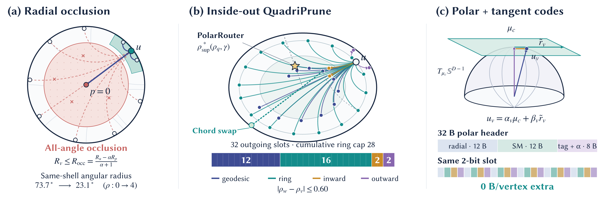
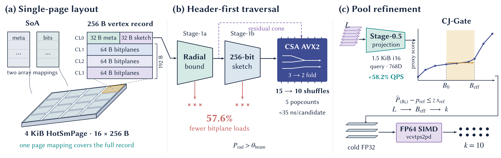

# Pelorus

**Warped-Product Graph Indexing for Hyperbolic Vector Search**

[](https://github.com/Astrmira/Pelorus/actions/workflows/ci.yml)
[](LICENSE)
[](Cargo.toml)

English | [简体中文](README.zh-CN.md)

**Pelorus** is a Rust approximate nearest neighbor (ANN) engine with memory-resident navigation and optional SSD-backed cold vectors designed for native **Poincaré ball** ($`\mathbb{B}_c^D`$) hyperbolic search (as well as standard cosine similarity). It bridges the fidelity–memory dilemma in million-scale non-Euclidean retrieval by decoupling hyperbolic embeddings into a warped product $`\mathbb{R}_{\ge 0} \times \mathbb{S}^{D-1}`$, combining compact 2-bit Sign-Magnitude (SM) spherical codes with exact unquantized radial/conformal metadata and full-precision tail reranking.

> **Package Naming Note:** This repository and its accompanying paper use the project name **Pelorus**; for compatibility with frozen benchmark harnesses and existing callers, the Rust crate currently keeps the package name `quiver-ann` (`use quiver_ann::...`). See [`docs/source-migration.md`](docs/source-migration.md) for historical symbol and directory mappings.

---

## Core Architecture & Highlights

- **Warped-Product Polar Quantization**: Pairs a **32-byte unquantized FP32 radial/conformal header** with scale-invariant **2-bit Sign-Magnitude (SM)** spherical bitplanes and **FP64** exact geodesic tail reranking, eliminating conformal distortion across radial shells without storing FP32 vectors in the hot navigation path.
- **Zero-Extra-Byte Tangent-Cone Residuals (`ResidualConeDict`)**: Inside tight boundary cones where global 2-bit directional quantization hits an error floor, Pelorus overwrites the vertex's existing 2-bit slot with its quantized tangent residual around a cone prototype—gated by cosine-purity—achieving **0 B/vertex additional hot memory**.
- **Curvature-Aware Graph Topology (`QuadriPrune` + Chord Swaps)**: Replaces flat Vamana pruning (which suffers from all-angle radial occlusion in negative curvature) with inside-out quadruplet pruning across geodesic, radial-ring, inward, and outward slots plus degree-preserving chord swaps, achieving **zero unreachable zero-in-degree islands** across all measured graphs.
- **Page-Co-Located SIMD Execution Engine**: Packs headers, stabilized 256-bit sketches (`SymSketch256`), and 2-bit bitplanes into **4096 B OS pages (`HotSmPage`)**; prunes bitplane loads by **57.6%** via Stage-0.5 i16 projection and Stage-1a/1b header-first bounds; evaluates bitplanes with a **3-to-2 carry-save AVX2** kernel (`< 35 ns/candidate`); and adapts reranking budgets via variance-calibrated **CJ-Gate**.

<p align="center">
  
</p>
<p align="center"><em>Figure 1: Negative-curvature radial occlusion in the Poincaré ball, inside-out <code>QuadriPrune</code> with degree-preserving chord swaps, and zero-extra-byte polar + tangent-cone residual coding.</em></p>

<p align="center">
  
</p>
<p align="center"><em>Figure 2: Single-page <code>HotSmPage</code> (4 KiB) vertex layout, header-first <code>SymSketch256</code> + 3-to-2 carry-save AVX2 bitplane scoring, and Stage-0.5 + <code>CJ-Gate</code> tail reranking.</em></p>

---

## Key Empirical Results

Measured on isolated **AMD EPYC 9654 (Zen 4)** Linux containers (32 build threads, 1–24 query threads, native AVX-512F/AVX2+FMA, exact FP64 ground truth; `M=16, L_c=128` for Pelorus, up to `M=32, L_c=256` for external baselines):

| Workload | Dimensions | Build (32T) | Hot Nav Mem | 1T QPS @99% | 24T QPS @99% | Highlight vs. Baselines |
| --- | --- | --- | --- | --- | --- | --- |
| **Cohere-1M** | 1M × 768D | 35.0 s | 485.0 MB* | 1,930 | 42,466 | **5.44×** faster build vs. `Polar-FP32`; **2.60×** less hot memory vs. `Polar-SQ8`; **4.30× / 6.31×** (1T/24T) higher QPS vs. `Polar-FP32` |
| **MERU-1M** | 1M × 512D | 25.7 s | 420.8 MB* | 2,547 | 53,483 | Reaches **99.25%** Recall@10; **3.37×–3.88×** faster 24T throughput than `HyperspaceDB FP32` |
| **OpenAI-1536** | 990K × 1536D | 43.6 s | 670.6 MB* | 792 | 14,731 | Sub-millisecond/low-latency high-dimensional mapped hyperbolic search |
| **WordNet-Hazy** | 83.9K × 20D | 1.5 s | 26.1 MB* | 3,089 | 65,405 | Native Lorentz-mapped taxonomy (`0.38 ms` 1T p99 at `99%` recall) |
| **Clustered-Narrow** | 1M × 512D | 25.3 s | — | 1,840 | 38,876 | Lifts recall from **34.22% → 99.385%** at `L=256` (`99.80%` at `L=384`); **1.84×–4.56×** over `HyperspaceDB` |

<sub>*Split hot-navigation allocation; 4096 B page-co-located (`HotSmPage`) footprints are 517.0 MB (Cohere-1M), 516.8 MB (MERU-1M), 765.6 MB (OpenAI-1536), and 32.8 MB (WordNet-Hazy).</sub>

> **Applicability Boundary (`Uniform-Narrow`)**: On isotropic narrow shells ($`\rho \in [3.9, 4.1]`$ with zero clusters), cone residuals cannot activate and 2-bit spherical margin-to-noise bounds peak Recall@10 at **64.735%**, whereas unquantized `HyperspaceDB FP32 flat` reaches **92.170%**. Full-precision or 8-bit representations remain preferable for uniformly distributed thin hyperbolic shells.

---

## Quick Start (Rust)

Clone the repository and run the core test suite and examples:

```bash
git clone https://github.com/Astrmira/Pelorus.git
cd Pelorus
cargo test --release --lib --tests
cargo run --release --example hyperbolic
cargo run --release --example basic
```

Add `quiver-ann` as a local path dependency in `Cargo.toml`:

```toml
[dependencies]
quiver-ann = { path = "../Pelorus" }
```

### Native Poincaré Hyperbolic Search

```rust
use quiver_ann::{BuildConfig, Index, PoincareNavigation, SearchConfig};

fn main() -> quiver_ann::Result<()> {
    let index = Index::build_poincare(
        2,
        &[100, 200, 300],
        &[0.1, 0.0, 0.4, 0.0, 0.0, 0.3],
        &BuildConfig::default(),
        1.0, // Positive finite curvature parameter c; inputs must satisfy c * ||x||^2 < 1
        PoincareNavigation::GeometryBq2,
    )?;

    let results = index.search(
        &[0.12, 0.0],
        &SearchConfig {
            top_k: 2,
            ef_search: 16,
            rerank_limit: None,
        },
    )?;

    assert_eq!(results[0].0, 100);
    Ok(())
}
```

### Cosine Search

```rust
use quiver_ann::{BuildConfig, Index, SearchConfig};

fn main() -> quiver_ann::Result<()> {
    let index = Index::build(
        2,
        &[100, 200],
        &[1.0, 0.0, 0.0, 1.0],
        &BuildConfig::default(),
    )?;

    let results = index.search(
        &[1.0, 0.0],
        &SearchConfig {
            top_k: 1,
            ef_search: 8,
            rerank_limit: None,
        },
    )?;

    assert_eq!(results[0].0, 100);
    Ok(())
}
```

### Dynamic Updates & Checksummed Persistence

```rust,no_run
use quiver_ann::{BuildConfig, Index};

fn main() -> quiver_ann::Result<()> {
    let mut index = Index::build(2, &[100], &[1.0, 0.0], &BuildConfig::default())?;
    index.insert(200, &[0.0, 1.0])?;
    index.remove(100);
    index.compact()?;

    index.save("vectors.quiver")?;
    let restored = Index::load("vectors.quiver")?;
    assert!(restored.contains(200));
    Ok(())
}
```

- **Coordinates & IDs**: Vectors are stored row-major; external IDs are unique `u64` values (`0` is supported). In Poincaré mode, curvature `c` must be finite and positive, and coordinates must satisfy $`c\|x\|_2^2 < 1`$.
- **Scoring & Exact Scan**: `search` returns `(id, score)` sorted in descending order—cosine similarity in cosine mode and negative geodesic distance in hyperbolic mode. `search_exact` performs a full scan under the same metric, deletion mask, and score convention.
- **Parallelism & Memory Accounting**: Graph construction uses the active Rayon thread pool. `navigation_storage_bytes()` reports the payload size of the graph and navigation state separately from raw vectors.

---

## SSD Storage & Reranking Precision

```rust,no_run
use quiver_ann::{Index, RerankConfig, RerankPrecision, ScalarQuantization, StorageMode};

fn main() -> quiver_ann::Result<()> {
    let mut index = Index::load("vectors.quiver")?;
    index.set_rerank_config(RerankConfig {
        precision: RerankPrecision::Sq8,
        scalar_quantization: ScalarQuantization::Centered,
        ..RerankConfig::default()
    })?;
    index.set_storage_mode(StorageMode::Mmap)?;
    index.save_snapshot("vectors.pelorus")?;
    let restored = Index::load_mmap("vectors.pelorus")?;
    assert_eq!(restored.rerank_config(), index.rerank_config());
    Ok(())
}
```

FP32, FP16, BF16, SQ8 and packed SQ4 are available for reranking. SQ supports per-vector symmetric scales, a shared corpus mean, and grouped affine scales/biases. Polar storage retains an FP64 squared radius and compresses the direction. Cartesian storage optionally adds norm correction. Compressed reranking uses FP64 arithmetic and the original FP32 query.

Encoded memory mode keeps pre-encoded reranking records in RAM and uses file-backed originals for `vector()`, `search_exact()` and maintenance. Encoding/loading prepares 16 bytes of FP64 scoring metadata per record. AVX2 and AVX-512 kernels fuse code reconstruction with FP64 accumulation, with scalar fallback. Storage statistics account for originals, encoded records and prepared metadata separately. Snapshot persistence writes an atomic entry file plus an immutable data file in the same directory, preserving readers of earlier generations. Backups include both files. Loading validates the snapshot and restores its actual graph and navigation state.

Run `cargo run --release --example ssd` for an executable example. The [storage guide](docs/storage.md) describes configurations, updates, file lifecycle and accounting.

On Linux, `Index::open_ssd(path, SsdCacheConfig::default())` enables `O_DIRECT` reranking reads with a bounded 128 MiB shared page cache and a 32 MiB in-flight buffer budget. The default io_uring driver uses one scheduler owning a depth-256 ring with a registered file and buffer slab, merging concurrent page reads and batching submission and completion. Registration pins the entire cache plus in-flight pool and requires sufficient `RLIMIT_MEMLOCK`. `ssd_io_stats()` reports cache hits, physical I/O, registered capacity, batches, peak in-flight reads and kernel IOWQ registration capabilities. Set `cache_bytes` to `512 * 1024 * 1024` for the larger cache.

---

## Reproducing Paper Figures & Benchmarks

- **Papers**:
  - [`paper/vldb_submission/main.tex`](paper/vldb_submission/main.tex) — 12-page PVLDB Vol. 20 camera/submission manuscript.
  - [`paper/vldb/main.tex`](paper/vldb/main.tex) — Full technical report with complete mathematical proofs and extended appendices.
- **Regenerate Vector PDF Figures & LaTeX Tables** (from archived measurement CSVs in `paper/vldb/figures/data/`):
  ```bash
  python paper/vldb/plot_figures.py
  ```
- **Run Research Benchmarks** (compile with `--features research`, exposing diagnostics under `quiver_ann::research`):
  ```bash
  cargo run --release --features research --example benchmark_geometry_sweep -- \
    --data DATA_DIR --n 1000000 --dim 768 --queries 1000 --build-threads 32 \
    --mode a8 --plan PLAN.json --output RESULT.jsonl
  ```
  See [`research/README.md`](research/README.md), [`research/benchmarks/README.md`](research/benchmarks/README.md), and [`research/experiments/README.md`](research/experiments/README.md) for dataset binary layouts (`documents.f32`, `queries.f32`, `truth.u64`), ablation mode labels (`a8`, `a7`, `sq8`, `fp32`), and manifest provenance.

---

## Repository Structure

```text
src/
  config.rs                Public BuildConfig & SearchConfig
  geometry.rs              Polar/SM representations & PoincareNavigation modes
  metric.rs                Distance kernels & manifold domain validation
  storage/                 Cold-vector codecs, mmap base layers & in-memory deltas
  vector.rs                Low-level vector primitives
  research.rs              Research feature hooks, strategy toggles & stage profiling
  index/                   Public Index API, validation, maintenance & persistence
  graph/                   Graph storage, parallel build, cosine search & prefiltering
    hyperbolic/            Polar routing, tangent-cone residuals, HotSmPage & search
  quantization/            2-bit SM coding, reconstruction & SIMD (AVX2 / AVX-512) kernels
examples/                  Standard cosine & Poincaré usage examples
tests/                     Core functional & public contract regression tests
benches/                   Criterion microbenchmarks
docs/                      Source migration & naming notes
research/                  Benchmark harnesses, experiment manifests & third-party refs
paper/
  vldb/                    Full technical report LaTeX sources, plots & provenance data
  vldb_submission/         12-page PVLDB submission manuscript
```

---

## Development & Verification

Commands matching [`.github/workflows/ci.yml`](.github/workflows/ci.yml) (CI runs on Linux, Windows, and macOS):

```bash
cargo fmt --all --check
cargo clippy --all-targets --all-features -- -D warnings
cargo test --locked --release --lib --tests
cargo test --locked --release --all-features --lib --tests -- --test-threads=1
cargo doc --no-deps --all-features
```

*(Feature-gated `research` tests run single-threaded to isolate process-wide experimental strategy switches.)*

---

## Citation

If you find Pelorus useful in your research, please cite:

```bibtex
@misc{xiao2026pelorus,
  author       = {Wenxuan Xiao and Xu Cao},
  title        = {{Pelorus}: Warped-Product Graph Indexing for Hyperbolic Vector Search},
  year         = {2026},
  howpublished = {\url{https://github.com/Astrmira/Pelorus}}
}
```

---

## License & Upstream Notice

Licensed under the **Apache License 2.0** ([`LICENSE`](LICENSE)). Upstream copyright attribution is preserved in [`NOTICE`](NOTICE).
