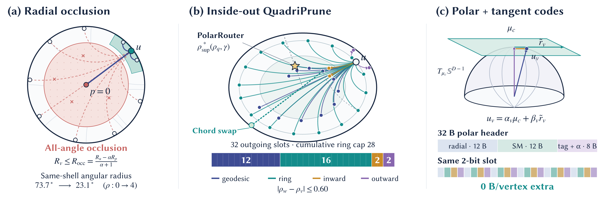
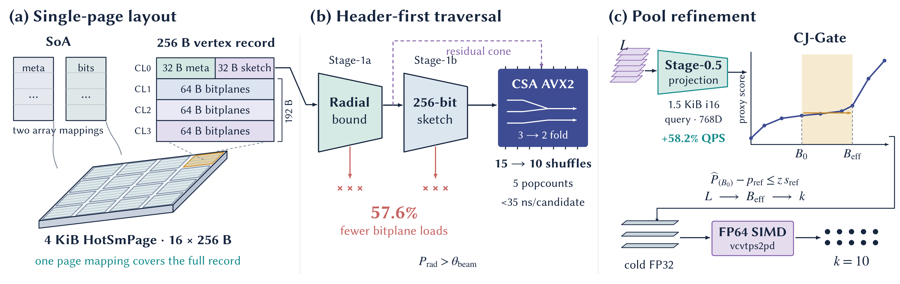

# Pelorus

**面向双曲向量检索的翘曲乘积图索引（Warped-Product Graph Indexing）**

[](https://github.com/Astrmira/Pelorus/actions/workflows/ci.yml)
[](LICENSE)
[](Cargo.toml)

[English](README.md) | 简体中文

**Pelorus** 是一个基于 Rust 实现的近似最近邻（ANN）检索引擎，支持常驻内存的导航结构与可选的 SSD 冷向量存储，面向 **Poincaré 球**（$`\mathbb{B}_c^D`$）原生双曲检索与常规余弦检索。针对百万级非欧空间检索中的“几何保真度 vs. 内存占用”两难问题，Pelorus 将双曲嵌入解耦为翘曲乘积 $`\mathbb{R}_{\ge 0} \times \mathbb{S}^{D-1}`$，把精确的 32 字节径向/共形元数据、尺度不变的两位符号幅值（Sign-Magnitude, SM）球面编码与 FP64 尾部精排结合起来，实现高召回、高吞吐且低内存的热路径导航。

> **命名说明**：本项目与对应论文名称为 **Pelorus**；为兼容既有基准脚本与调用方，Rust crate 名称当前保留为 `quiver-ann`（代码中为 `use quiver_ann::...`）。历史命名对照与模块迁移见 [`docs/source-migration.md`](docs/source-migration.md)。

---

## 核心机制与架构亮点

- **翘曲乘积极坐标量化**：将 **32 字节未量化 FP32 径向/共形头**（半径、共形因子、范数与标签）与尺度不变的 **2-bit SM 球面位平面** 耦合，并在尾部执行 **FP64 精确测地距离重排**，在热搜索路径上彻底摆脱跨壳层内积代理失真与全精度向量读取开销。
- **零额外字节切锥残差编码（`ResidualConeDict`）**：针对紧致边界锥内全局 2-bit 方向量化遇阻的召回下限问题，由余弦纯度门控将锥内顶点现有的 2-bit 槽位直接覆写为绕锥原型的量化切向残差，做到 **0 B/顶点额外热内存开销**。
- **负曲率拓扑感知构图（`QuadriPrune` + 弦交换）**：针对双曲空间中平坦 Vamana 剪枝遭遇的全角径向遮挡，采用由内向外的四元组槽位剪枝（测地线、径向环带、向内/向外槽位）配合保度数弦交换，在所有实测图上实现 **0 个入度为零的孤岛节点**。
- **单页合表与 SIMD 硬件协同执行**：将元信息、稳定化 256-bit 草图（`SymSketch256`）与 2-bit 位平面紧凑排列在 **4096 B OS 页（`HotSmPage`）** 内；通过 Stage-0.5 i16 投影与 Stage-1a/1b 头部边界过滤削减 **57.6%** 的位平面加载；采用 **3-to-2 进位保留（CSA）AVX2** 内核评分（`< 35 ns/候选`）；并通过方差校准的 **CJ-Gate** 自适应分配精排预算。

<p align="center">
  
</p>
<p align="center"><em>图 1：Poincaré 球上的全角径向遮挡、由内向外 <code>QuadriPrune</code> + 弦交换构图，以及零额外字节极坐标与切锥残差编码。</em></p>

<p align="center">
  
</p>
<p align="center"><em>图 2：单页 <code>HotSmPage</code>（4 KiB）顶点布局、头部优先 <code>SymSketch256</code> + 3-to-2 CSA AVX2 位平面评分，以及 Stage-0.5 与 <code>CJ-Gate</code> 尾部精排流程。</em></p>

---

## 核心实测结果

以下结果实测于隔离的 **AMD EPYC 9654（Zen 4）** Linux 容器环境（32 线程构图、1–24 线程查询、原生 AVX-512F/AVX2+FMA 编译、FP64 精确 Ground Truth；Pelorus 采用 `M=16, L_c=128`，外部基线允许最高 `M=32, L_c=256`）：

| 数据集 | 规模与维度 | 32T 构图耗时 | 热导航内存 | 1T QPS (@99%) | 24T QPS (@99%) | 相对基线核心提升 |
| --- | --- | --- | --- | --- | --- | --- |
| **Cohere-1M** | 1M × 768D | 35.0 s | 485.0 MB* | 1,930 | 42,466 | 构图较 `Polar-FP32` 快 **5.44×**；热内存较 `Polar-SQ8` 省 **2.60×**；`@99%` 吞吐较 `Polar-FP32` 提升 **4.30× / 6.31×**（1T/24T） |
| **MERU-1M** | 1M × 512D | 25.7 s | 420.8 MB* | 2,547 | 53,483 | 达到 **99.25%** Recall@10；24T 吞吐为 `HyperspaceDB FP32` 的 **3.37×–3.88×** |
| **OpenAI-1536** | 990K × 1536D | 43.6 s | 670.6 MB* | 792 | 14,731 | 高维双曲映射下保持亚毫秒至毫秒级高召回检索 |
| **WordNet-Hazy** | 83.9K × 20D | 1.5 s | 26.1 MB* | 3,089 | 65,405 | 原生 Lorentz 映射分类体系（1T `@99%` p99 延迟 `0.38 ms`） |
| **Clustered-Narrow** | 1M × 512D | 25.3 s | — | 1,840 | 38,876 | `L=256` 下召回率从 **34.22% 跃升至 99.385%**（`L=384` 达 `99.80%`）；综合领先 `HyperspaceDB` **1.84×–4.56×** |

<sub>*上表热导航内存为分离存储口径；采用 4096 B <code>HotSmPage</code> 单页合表布局时对应内存分别为 517.0 MB（Cohere-1M）、516.8 MB（MERU-1M）、765.6 MB（OpenAI-1536）与 32.8 MB（WordNet-Hazy）。</sub>

> **适用边界提示（`Uniform-Narrow`）**：在各向同性极窄壳层（$`\rho \in [3.9, 4.1]`$、无聚簇结构）上，由于无法形成可激活的切锥聚类且受限于 2-bit 球面信噪边际（MNR），Pelorus 峰值 Recall@10 为 **64.735%**（全精度 `HyperspaceDB FP32 flat` 可达 **92.170%**）。对于均匀分布的超薄双曲壳层，全精度或 8-bit 方向表示仍是更合适的选择。

---

## 快速开始（Rust）

在仓库根目录运行核心测试与示例：

```powershell
git clone https://github.com/Astrmira/Pelorus.git
cd Pelorus
cargo test --release --lib --tests
cargo run --release --example hyperbolic
cargo run --release --example basic
```

通过本地路径集成到你的工程（`Cargo.toml`）：

```toml
[dependencies]
quiver-ann = { path = "../Pelorus" }
```

### 原生 Poincaré 双曲检索

```rust
use quiver_ann::{BuildConfig, Index, PoincareNavigation, SearchConfig};

fn main() -> quiver_ann::Result<()> {
    let index = Index::build_poincare(
        2,
        &[100, 200, 300],
        &[0.1, 0.0, 0.4, 0.0, 0.0, 0.3],
        &BuildConfig::default(),
        1.0, // 正有限曲率参数 c；输入向量须满足 c * ||x||^2 < 1
        PoincareNavigation::GeometryBq2,
    )?;

    let results = index.search(
        &[0.12, 0.0],
        &SearchConfig {
            top_k: 2,
            ef_search: 16,
            rerank_limit: None,
        },
    )?;

    assert_eq!(results[0].0, 100);
    Ok(())
}
```

### 余弦相似度检索

```rust
use quiver_ann::{BuildConfig, Index, SearchConfig};

fn main() -> quiver_ann::Result<()> {
    let index = Index::build(
        2,
        &[100, 200],
        &[1.0, 0.0, 0.0, 1.0],
        &BuildConfig::default(),
    )?;

    let results = index.search(
        &[1.0, 0.0],
        &SearchConfig {
            top_k: 1,
            ef_search: 8,
            rerank_limit: None,
        },
    )?;

    assert_eq!(results[0].0, 100);
    Ok(())
}
```

### 动态增删、压缩与校验和持久化

```rust,no_run
use quiver_ann::{BuildConfig, Index};

fn main() -> quiver_ann::Result<()> {
    let mut index = Index::build(2, &[100], &[1.0, 0.0], &BuildConfig::default())?;
    index.insert(200, &[0.0, 1.0])?;
    index.remove(100);
    index.compact()?;

    index.save("vectors.quiver")?;
    let restored = Index::load("vectors.quiver")?;
    assert!(restored.contains(200));
    Ok(())
}
```

- **坐标与标识约定**：向量按行连续存放；外部标识为唯一 `u64`（支持 `0`）。Poincaré 模式要求曲率参数 `c` 为正有限数，且所有底库与查询坐标满足 $`c\|x\|_2^2 < 1`$。
- **返回分数与精确扫描**：查询返回 `(id, score)` 并按分数降序排列（余弦模式为余弦相似度，双曲模式为负测地距离）。`search_exact` 使用相同的几何、删除掩码和分数约定执行全库扫描。
- **并行与内存统计**：构图通过当前 Rayon 线程池执行；`navigation_storage_bytes()` 返回图邻接与导航载荷字节数（原始底库向量单独计算）。

---

## SSD 存储与重排精度

```rust,no_run
use quiver_ann::{Index, RerankConfig, RerankPrecision, ScalarQuantization, StorageMode};

fn main() -> quiver_ann::Result<()> {
    let mut index = Index::load("vectors.quiver")?;
    index.set_rerank_config(RerankConfig {
        precision: RerankPrecision::Sq8,
        scalar_quantization: ScalarQuantization::Centered,
        ..RerankConfig::default()
    })?;
    index.set_storage_mode(StorageMode::Mmap)?;
    index.save_snapshot("vectors.pelorus")?;
    let restored = Index::load_mmap("vectors.pelorus")?;
    assert_eq!(restored.rerank_config(), index.rerank_config());
    Ok(())
}
```

重排支持 FP32、FP16、BF16、SQ8 与真实半字节打包的 SQ4。SQ 提供逐向量对称尺度、共享集合均值中心化及分组仿射尺度/偏置。极坐标模式保存 FP64 半径平方并压缩方向，笛卡尔模式可增加范数校正。压缩重排使用 FP64 运算，查询保持原始 FP32。

量化内存模式仅将预编码重排记录常驻主存，原始FP32以文件映射供 `vector()`、`search_exact()` 和维护按需访问。编码或加载时准备每记录16 B的FP64评分元数据，AVX2与AVX-512融合码字重构和FP64累加，并提供标量回退。空间统计将原始、编码记录及准备元数据单列。快照由原子发布的入口文件及同目录不可变数据文件组成，支持旧代读者继续查询，备份需包含两者。加载会校验快照并直接恢复保存的实际图与导航状态。

可执行示例使用 `cargo run --release --example ssd` 运行。配置、增量写入、文件生命周期和统计口径见[存储指南](docs/storage.md)。

Linux 下可用 `Index::open_ssd(path, SsdCacheConfig::default())` 启用 `O_DIRECT` 重排读取、默认 128 MiB 共享页缓存和 32 MiB 在途缓冲预算。默认 io_uring 驱动由单调度线程管理深度 256 的固定文件、固定缓冲队列，合并并发同页读取并批量提交、回收异步预读。FP32 冷重排还会合并同一提交批次内最多 8 个连续缺页；其他精度逐页提交。系统读取次数按物理请求计。整个缓存与在途池注册为锁定内存，需有相应的 `RLIMIT_MEMLOCK`。`ssd_io_stats()` 报告缓存命中、物理 I/O、注册容量、批次、在途峰值及内核 IOWQ 注册能力。将 `cache_bytes` 设为 `512 * 1024 * 1024` 即可使用更大的缓存池。

---

## 论文、图表与基准复现

- **论文源码**：
  - [`paper/vldb_submission/main.tex`](paper/vldb_submission/main.tex) — 12 页 PVLDB Vol. 20 投稿正稿。
  - [`paper/vldb/main.tex`](paper/vldb/main.tex) — 完整技术报告（含全部数学定理推导与补充附录）。
- **从归档实测数据重绘矢量图与表格**（数据源于 `paper/vldb/figures/data/`）：
  ```powershell
  python paper/vldb/plot_figures.py
  ```
- **运行研究级 ANN 测量入口**（开启 `research` feature，诊断接口位于 `quiver_ann::research`）：
  ```powershell
  cargo run --release --features research --example benchmark_geometry_sweep -- --data DATA_DIR --n 1000000 --dim 768 --queries 1000 --build-threads 32 --mode a8 --plan PLAN.json --output RESULT.jsonl
  ```
  完整二进制数据格式（`documents.f32`、`queries.f32`、`truth.u64`）、模式标签（`a8`、`a7`、`sq8`、`fp32`）及冻结实验清单说明请参见 [`research/README.md`](research/README.md)、[`research/benchmarks/README.md`](research/benchmarks/README.md) 与 [`research/experiments/README.md`](research/experiments/README.md)。

---

## 仓库目录结构

```text
src/
  config.rs                公开构建与查询配置（BuildConfig / SearchConfig）
  geometry.rs              极坐标/SM 量化表示与 PoincareNavigation 模式
  metric.rs                距离计算与流形域校验
  storage/                 冷向量编码、mmap 基础层与内存增量层
  vector.rs                基础向量算子
  research.rs              research feature 下的策略配置与阶段诊断接口
  index/                   公开 Index API、参数校验、动态维护与持久化
  graph/                   图存储、并行构建、余弦检索与属性预筛
    hyperbolic/            极坐标路由、切锥残差、HotSmPage 与双曲搜索
  quantization/            两位签名、SM 重构与 AVX2 / AVX-512 SIMD 内核
examples/                  常规余弦与双曲使用示例
tests/                     核心功能与公共契约回归测试
benches/                   Criterion 微基准测试
docs/                      源码命名与目录迁移说明
research/                  测量程序、实验清单索引与第三方来源记录
paper/
  vldb/                    完整版技术报告源码、绘图表脚本与实测数据
  vldb_submission/         12 页 PVLDB 投稿精修版源码
```

---

## 开发与 CI 验证

与 [`.github/workflows/ci.yml`](.github/workflows/ci.yml) 对齐的完整校验命令（已覆盖 Linux、Windows 与 macOS）：

```powershell
cargo fmt --all --check
cargo clippy --all-targets --all-features -- -D warnings
cargo test --locked --release --lib --tests
cargo test --locked --release --all-features --lib --tests -- --test-threads=1
cargo doc --no-deps --all-features
```

*（`research` feature 测试需单线程串行执行，以隔离进程级策略开关。）*

---

## 引用方式

如果 Pelorus 对你的研究或工程有所帮助，欢迎引用：

```bibtex
@misc{xiao2026pelorus,
  author       = {Wenxuan Xiao and Xu Cao},
  title        = {{Pelorus}: Warped-Product Graph Indexing for Hyperbolic Vector Search},
  year         = {2026},
  howpublished = {\url{https://github.com/Astrmira/Pelorus}}
}
```

---

## 许可证与上游声明

本仓库采用 **Apache License 2.0** 开源协议（[`LICENSE`](LICENSE)）。上游版权声明保留于 [`NOTICE`](NOTICE)。
